  

<strong>Master of Artificial Intelligence · Monash University Malaysia</strong> 
Bachelor of Information Systems (Honours), Data Analytics · Sunway University

  <a href="https://www.linkedin.com/in/siobhan-goh/">LinkedIn</a> &nbsp;·&nbsp;
  <a href="https://github.com/SiobhanGoh?tab=repositories">Repositories</a> &nbsp;·&nbsp;
  <a href="https://retailai-adaptive-intelligence.streamlit.app/">RetailAI demo</a> &nbsp;·&nbsp;
  <a href="https://huggingface.co/spaces/SiobhanGoh/emotion-detection-malaybert-skeleton">NLP demo</a>

Currently interested in full-time internships across AI/ML, data science, analytics and business intelligence · November 2026–February 2027

---

### A little about me

I turn complex data into useful **analyses, experiments and applications**. My background connects statistical reasoning, machine learning, NLP and business intelligence. I enjoy both sides of the process: **building models** and **explaining what their results do—and do not—mean**.

I am particularly interested in projects where the technical work supports real decisions, from multilingual text classification to retail analytics and interpretable forecasting.

**Explore:** [Featured builds](#featured-builds) · [Graduate research](#selected-graduate-research) · [Toolkit](#toolkit) · [Connect](#lets-connect)

### Featured builds

| | Project and contribution |
|:---:|---|
| **01** | **[RetailAI — Adaptive Sales Intelligence & Recommendation Platform](https://github.com/SiobhanGoh/RetailAI-Adaptive-Sales-Intelligence)**   Modular Streamlit application for business KPIs, sales exploration, weekly forecasting, product-similarity recommendations and PDF reports.  [Explore source](https://github.com/SiobhanGoh/RetailAI-Adaptive-Sales-Intelligence) · [Live app](https://retailai-adaptive-intelligence.streamlit.app/) |
| **02** | **[Malay–English Sentiment Analysis](https://github.com/SiobhanGoh/capstone2-sentiment-streamlit-colab)**   Transformer-powered three-class sentiment analysis with single-text inference, YouTube comment workflows, visual summaries and PDF/CSV exports.  [Explore source](https://github.com/SiobhanGoh/capstone2-sentiment-streamlit-colab) · [Live demo](https://huggingface.co/spaces/SiobhanGoh/emotion-detection-malaybert-skeleton) |

> These are portfolio prototypes and academic projects—not validated production decision systems. See individual READMEs for model-evaluation limitations.

### Selected graduate research

Beyond my published apps, my master's coursework includes **implemented** work in R-based analytics, deep learning and model evaluation:

- **BloodReady AI · R / Forecasting:** analysed Malaysian blood-donation records, compared four interpretable forecast approaches over retrospective years, and reported low-collection-day limitations. *A reproducible R Markdown analysis, not a deployed Shiny app.*
- **Deep Learning · PyTorch / Transformers:** implemented neural networks, sequence classifiers, a scratch Transformer and BERT fine-tuning, with training, evaluation and checkpoint-handling workflows.
- **Computer Vision · Transfer Learning:** explored ensemble inference with frozen pretrained CLIP, SigLIP, SigLIP2 and DINOv2 encoders, including low-resolution validation checks.

<strong>What I'm learning about rigorous evaluation</strong>

 
Research and application development require more than a high metric. My recent work has involved chronological evaluation, baseline comparisons, feature-selection controls, validation-set limitations and correcting problematic preprocessing. I prefer to document uncertainty and use models as decision-support tools rather than promising unsupported accuracy or business impact.

### Toolkit

**Languages & analysis** · Python · R · Pandas · NumPy · scikit-learn · statistical modelling  
**Machine learning & NLP** · PyTorch · Transformers · BERT fine-tuning · classical ML · model evaluation  
**Visualisation & applications** · Streamlit · Plotly · Matplotlib · ggplot2 · R Markdown · ReportLab  
**Exploratory tools** · Jupyter / Google Colab · GitHub · Hugging Face Spaces

<strong>Additional technical work</strong>

 
Selected work also includes Bayesian-network inference and decision analysis, large-file Bash/AWK data processing, model-selection diagnostics and research-led interface design. I only share course material publicly when publication is permitted and private information has been removed.

### Let's connect

I'm open to internship opportunities across **AI, Machine Learning, Data Science, Data Analytics and Business Intelligence**. The best way to reach me is via [LinkedIn](https://www.linkedin.com/in/siobhan-goh/).

Thoughtful models. Clear analysis. Useful outcomes. ♡
