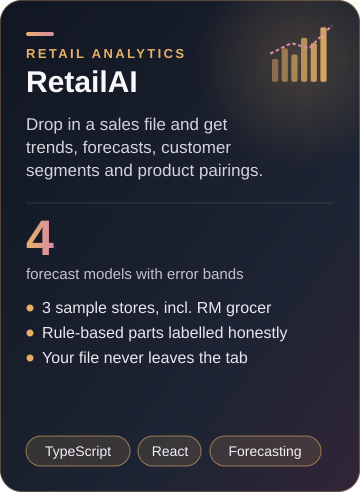
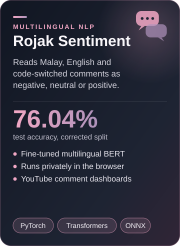
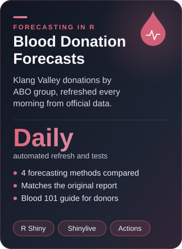

  

<strong>Master of Artificial Intelligence · Monash University Malaysia</strong> 
Bachelor of Information Systems (Honours), Data Analytics · Sunway University

  <a href="https://www.linkedin.com/in/siobhan-goh/">LinkedIn</a> &nbsp;·&nbsp;
  <a href="https://github.com/SiobhanGoh?tab=repositories">Repositories</a> &nbsp;·&nbsp;
  <a href="https://siobhangoh.github.io/RetailAI-Adaptive-Sales-Intelligence/">RetailAI app</a> &nbsp;·&nbsp;
   &nbsp;·&nbsp;
  <a href="https://siobhangoh.github.io/klang-valley-blood-donation-dashboard/">Blood donation dashboard</a>

Currently interested in full-time internships across AI/ML, data science, analytics and business intelligence · November 2026–February 2027

### Projects at a glance

<table>
  <tr>
    <td width="33%" valign="top" align="center">
       
      <a href="https://siobhangoh.github.io/RetailAI-Adaptive-Sales-Intelligence/"><b>Live app</b></a> · <a href="https://github.com/SiobhanGoh/RetailAI-Adaptive-Sales-Intelligence">Code</a> · <a href="#01--retailai--adaptive-sales-intelligence">Details ↓</a>
    </td>
    <td width="33%" valign="top" align="center">
       
       ·  · <a href="#02--malayenglish-sentiment-analysis">Details ↓</a>
    </td>
    <td width="33%" valign="top" align="center">
       
      <a href="https://siobhangoh.github.io/klang-valley-blood-donation-dashboard/"><b>Live app</b></a> · <a href="https://github.com/SiobhanGoh/klang-valley-blood-donation-dashboard">Code</a> · <a href="#03--klang-valley-blood-donation-forecasts">Details ↓</a>
    </td>
  </tr>
</table>

---

### A little about me

I turn complex data into useful **analyses, experiments and applications**. My background connects statistical reasoning, machine learning, NLP and business intelligence. I enjoy both sides of the process: **building models** and **explaining what their results do—and do not—mean**.

I am particularly interested in projects where the technical work supports real decisions, from multilingual text classification to retail analytics and interpretable forecasting.

**Explore:** [Featured builds](#featured-builds) · [Graduate research](#selected-graduate-research) · [Toolkit](#toolkit) · [Connect](#lets-connect)

### Featured builds

I keep revisiting my past projects rather than leaving them as they were first submitted: re-checking the results, fixing what fell short and rebuilding when a better design is possible. Each project lists what changed in its latest round.

#### 01 · [RetailAI — Adaptive Sales Intelligence](https://github.com/SiobhanGoh/RetailAI-Adaptive-Sales-Intelligence)
First built May 2026 · rebuilt as version 2 in November 2026

Open a CSV or Excel sales export and get trends, forecasts, customer segments and product pairings, all calculated in your browser. Three sample stores (US, UK and Malaysia) let you try it straight away.

**What improved in version 2**
- **New platform:** moved off Streamlit to a fast browser app that doesn't sleep. Your file never leaves the tab.
- **Stronger, more honest analysis:** four forecasting models tested on past weeks, with error bands from their real mistakes, more careful data handling and misleading labels removed.
- **Redesigned UI/UX:** a new interface with plain-words explanations, Bahasa Malaysia, accessibility checks and phone layouts.
- **New features and data:** customer segments, product pairings, shareable views, and two new sample stores built from real UK and official Malaysian data.

[Live app](https://siobhangoh.github.io/RetailAI-Adaptive-Sales-Intelligence/) · [Explore source](https://github.com/SiobhanGoh/RetailAI-Adaptive-Sales-Intelligence)

#### 02 · [Malay–English Sentiment Analysis](https://github.com/SiobhanGoh/capstone2-sentiment-streamlit-colab)
First built December 2025 · re-evaluated October 2026 · rebuilt November 2026

Negative / Neutral / Positive sentiment for Malay, English and code-switched text.

**What improved**
- **Corrected evaluation:** the original train/test splits overlapped, so I rebuilt the evaluation on a clean, disjoint split (76.04% test accuracy).
- **Better model:** test accuracy is now **80.33%**. I trained larger XLM-RoBERTa models on Kaggle's free GPUs and distilled them into a model small enough for a browser. Every choice was made on validation, and ideas that didn't help were recorded and left out. Full results and caveats are in the repo.
- **Private, always-on web app:** the model runs in the visitor's browser, so their text never leaves the device.
- **Advanced UI/UX:** YouTube comment dashboards, explanations for each label, video comparisons and downloadable reports.

[Live web app](https://capstone2-sentiment-streamlit-colab.pages.dev/) · [Explore source](https://github.com/SiobhanGoh/capstone2-sentiment-streamlit-colab) · [Original Streamlit demo](https://huggingface.co/spaces/SiobhanGoh/emotion-detection-malaybert-skeleton) (wakes up after a minute when idle)

#### 03 · [Klang Valley Blood Donation Forecasts](https://github.com/SiobhanGoh/klang-valley-blood-donation-dashboard)
November 2026 · grew out of my BloodReady AI analysis

A dashboard of daily blood-donation collections in the Klang Valley by ABO blood group, with all the analysis in R.

**What improved**
- **From one-off report to live dashboard:** my BloodReady R Markdown analysis now refreshes every morning from data.gov.my through a tested, automated pipeline. It is still checked against the original report's results.
- **Much faster:** rebuilt as a static site that opens in a second or two, down from up to a minute.
- **Advanced UI/UX:** a story-style layout, plain-words explanations beside every chart, light and dark themes, phone layouts and printable reports.

[Live dashboard](https://siobhangoh.github.io/klang-valley-blood-donation-dashboard/) · [Explore source](https://github.com/SiobhanGoh/klang-valley-blood-donation-dashboard)

> These are portfolio prototypes and academic projects—not validated production decision systems. See individual READMEs for model-evaluation limitations.

### Selected graduate research

Beyond my published apps, my master's coursework includes **implemented** work in R-based analytics, deep learning and model evaluation:

- **BloodReady AI · R / Forecasting:** analysed Malaysian blood-donation records, compared four interpretable forecast approaches over retrospective years, and reported low-collection-day limitations. *The R Markdown analysis is now the basis of the [live dashboard](https://github.com/SiobhanGoh/klang-valley-blood-donation-dashboard), whose tests confirm it still reproduces the report's results.*
- **Deep Learning · PyTorch / Transformers:** implemented neural networks, sequence classifiers, a scratch Transformer and BERT fine-tuning, with training, evaluation and checkpoint-handling workflows.
- **Computer Vision · Transfer Learning:** explored ensemble inference with frozen pretrained CLIP, SigLIP, SigLIP2 and DINOv2 encoders, including low-resolution validation checks.

<strong>What I'm learning about rigorous evaluation</strong>

 
Research and application development require more than a high metric. My recent work has involved chronological evaluation, baseline comparisons, feature-selection controls, validation-set limitations and correcting problematic preprocessing. I prefer to document uncertainty and use models as decision-support tools rather than promising unsupported accuracy or business impact.

### Toolkit

**Languages & analysis** · Python · R · TypeScript · Pandas · NumPy · scikit-learn · statistical modelling  
**Machine learning & NLP** · PyTorch · Transformers · BERT fine-tuning · classical ML · model evaluation  
**Visualisation & applications** · React · R Shiny · Streamlit · Plotly · Matplotlib · ggplot2 · R Markdown · ReportLab  
**Deployment & tools** · ONNX / transformers.js · Kaggle GPUs · GitHub Actions · GitHub Pages · Cloudflare Pages · Hugging Face Spaces · Jupyter / Google Colab

<strong>Additional technical work</strong>

 
Selected work also includes Bayesian-network inference and decision analysis, large-file Bash/AWK data processing, model-selection diagnostics and research-led interface design. I only share course material publicly when publication is permitted and private information has been removed.

### Let's connect

I'm open to internship opportunities across **AI, Machine Learning, Data Science, Data Analytics and Business Intelligence**. The best way to reach me is via [LinkedIn](https://www.linkedin.com/in/siobhan-goh/).

Thoughtful models. Clear analysis. Useful outcomes. ♡
